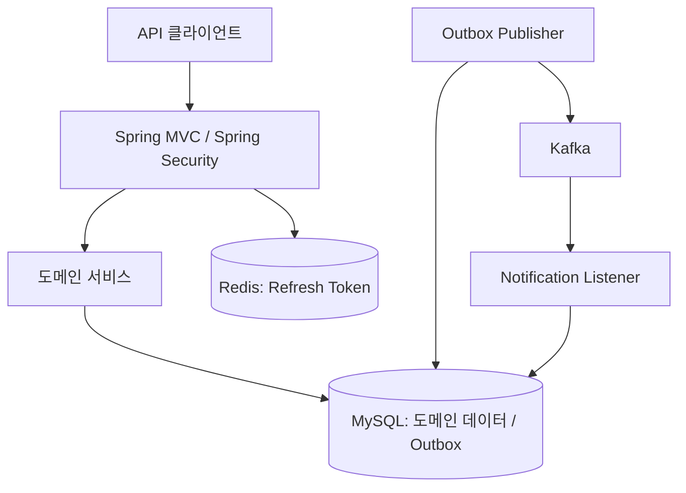
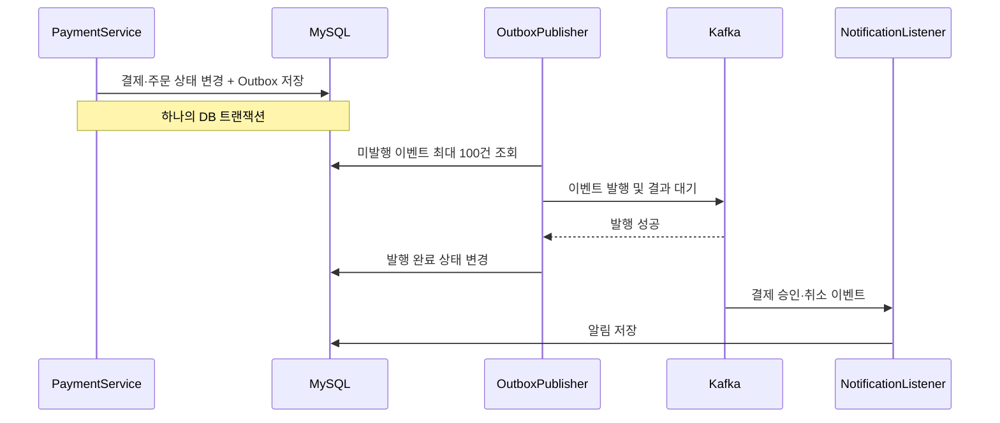
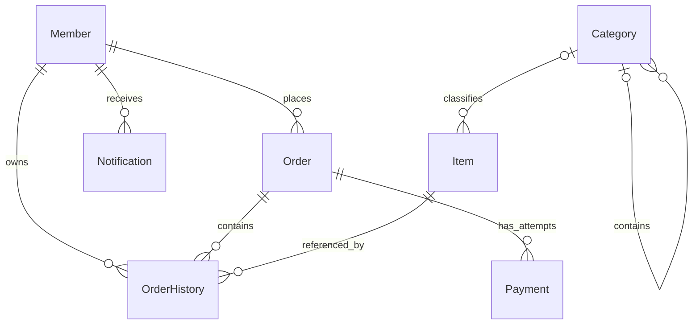

# Shopping Backend

Java 21과 Spring Boot 기반의 쇼핑몰 백엔드 프로젝트입니다. 회원·상품·카테고리·주문·결제를 관리하며, JWT 인증과 역할별 접근 제어를 적용했습니다. 결제 승인·취소 이벤트는 Transactional Outbox와 Kafka를 통해 알림 처리로 전달합니다.

단일 Spring Boot 애플리케이션을 도메인별 패키지로 구성했습니다. 프런트엔드 구현은 이 문서의 범위에서 제외합니다.

## 목차

1. [기술 스택](#1-기술-스택)
2. [주요 기능](#2-주요-기능)
3. [시스템 구조](#3-시스템-구조)
4. [핵심 설계와 처리 흐름](#4-핵심-설계와-처리-흐름)
5. [데이터 모델](#5-데이터-모델)
6. [주요 API](#6-주요-api)
7. [로컬 실행 방법](#7-로컬-실행-방법)
8. [테스트](#8-테스트)
9. [현재 개발 범위와 개선 과제](#9-현재-개발-범위와-개선-과제)

## 1. 기술 스택

버전은 저장소의 Gradle 및 Docker Compose 설정을 기준으로 표기했습니다.

| 구분 | 기술 | 사용 목적 |
| --- | --- | --- |
| 언어 | Java 21 | 백엔드 개발 |
| 프레임워크 | Spring Boot 4.1.1, Spring MVC | REST API |
| 보안 | Spring Security, JWT, BCrypt | 인증·인가, 비밀번호 해시 |
| 데이터 접근 | Spring Data JPA | 엔티티 영속성 및 트랜잭션 |
| DB | MySQL 8.4.11 | 서비스 데이터 저장 |
| 토큰 저장 | Redis 7.2.16 | Refresh Token 저장 및 만료 관리 |
| 메시징 | Apache Kafka 4.3.1 | 결제 이벤트 전달 |
| 빌드 | Gradle Wrapper 9.7.1 | 빌드 및 테스트 |
| 개발 환경 | Docker Compose | MySQL·Redis·Kafka 실행 |
| 테스트 | JUnit, Spring Boot Test, MockMvc, H2 | 인증 및 API 검증 |

Redis 연결은 Reactive Redis 의존성을 사용합니다. HTTP API는 Spring MVC 기반입니다. Java 가상 스레드는 `spring.threads.virtual.enabled=true`로 설정되어 있습니다.

## 2. 주요 기능

| 도메인 | 기능 |
| --- | --- |
| 회원 | 회원가입, 내 정보 조회·수정, 비밀번호 변경, 탈퇴 |
| 인증 | 로그인, 로그아웃, Access Token 재발급 |
| 관리자 | 회원 목록 조회, 회원 역할 변경 |
| 상품 | 도서·상의·하의·외투·신발 등록·조회·수정, 논리 삭제, 재고 관리 |
| 카테고리 | 계층형 카테고리 조회·등록·수정·삭제 |
| 주문 | 금액 검증, 회원 등급별 할인, 주문 생성·조회·취소, 상세 이력 저장 |
| 결제 | 결제 시도 생성, 승인·취소 상태 관리, 이벤트 저장 |
| 알림 | 결제 이벤트 수신, 알림 데이터 저장 |

## 3. 시스템 구조



Docker Compose는 인프라 서비스만 실행합니다. Backend는 JDK 또는 IDE에서 별도로 실행합니다. Publisher와 Listener도 동일한 Backend 애플리케이션 내부에서 동작합니다.

### 패키지 구성

소스 기준 경로는 `back/src/main/java/com/shopping`입니다.

| 패키지 | 책임 |
| --- | --- |
| `common/config` | Security 및 JPA Auditing 설정 |
| `common/security`, `common/jwt` | 로그인·요청 인증 필터, JWT 생성·검증 |
| `common/redis` | Refresh Token 저장소 |
| `common/kafka`, `common/outbox` | Kafka 설정, 이벤트 저장 및 발행 |
| `common/dto`, `common/exception` | 공통 응답 및 예외 처리 |
| `member` | 회원·관리자 기능 |
| `item` | 상품·카테고리·재고 |
| `order` | 주문 및 주문 상세 이력 |
| `payment` | 결제 상태 및 이벤트 |
| `notification` | 결제 이벤트 소비 및 알림 저장 |

각 도메인은 필요에 따라 Controller, Service, Repository, Entity, DTO로 구성됩니다.

## 4. 핵심 설계와 처리 흐름

### JWT 인증 및 권한 제어

1. `POST /login`에서 JSON의 `memId`, `password`로 인증합니다.
2. 비밀번호는 BCrypt로 검증합니다.
3. 로그인 성공 시 Access Token을 `Authorization` 응답 헤더에 반환합니다. 값에는 `Bearer ` 접두사가 포함됩니다.
4. Refresh Token은 Redis에 저장하고 `Refresh-Token` HttpOnly 쿠키로 전달합니다. 저장된 토큰이 있으면 재사용합니다.
5. 이후 요청은 `Authorization: Bearer <access-token>` 헤더로 인증합니다.
6. 로그아웃은 Redis의 Refresh Token을 삭제하고 쿠키를 제거합니다.

JWT 서명은 HMAC512를 사용하며, 기본 만료 시간은 Access Token 30분, Refresh Token 7일입니다. 서버 세션은 사용하지 않습니다. 로그아웃 시 기존 Access Token을 즉시 무효화하는 별도 블랙리스트는 구현되어 있지 않습니다.

상품 조회와 회원가입은 비로그인 접근을 허용합니다. 상품 등록·수정·삭제는 `SELLER` 또는 `ADMIN`, `/admin/**`는 `ADMIN` 역할이 필요합니다. 그 외 요청은 기본적으로 인증이 필요합니다.

현재 `POST /common/refresh`도 Security 설정상 Access Token 인증이 필요합니다. 따라서 Access Token이 만료된 뒤 Refresh Token만으로 재발급하는 흐름은 개선이 필요합니다. 재발급 시 새 Access Token은 응답 본문 문자열로 반환합니다.

### 상품 모델링과 재고 관리

- `Item`은 `SINGLE_TABLE` 상속 전략과 `dtype` 구분 컬럼을 사용합니다.
- 공통 속성은 `Item`, 유형별 속성은 `Book`, `Top`, `Bottom`, `Outer`, `Shoes`에서 관리합니다.
- 상품 삭제는 `deleted=true`로 처리하고, 일반 조회에서는 삭제된 상품을 제외합니다.
- 재고 증감 및 상품 변경 시 `PESSIMISTIC_WRITE` 잠금 조회를 사용합니다.
- 재고 차감 시 부족 여부를 검증하고, 부족하면 예외를 발생시킵니다.
- 카테고리는 부모·자식 관계를 가지며, 부모 변경 시 순환 관계를 검사합니다.

관련 코드: [Item](back/src/main/java/com/shopping/item/entity/Item.java), [ItemRepository](back/src/main/java/com/shopping/item/repository/ItemRepository.java), [ItemService](back/src/main/java/com/shopping/item/service/ItemService.java).

### 주문 생성과 취소

주문 생성은 `OrderService`의 트랜잭션에서 다음 작업을 수행합니다.

1. 활성 회원을 조회합니다.
2. DB의 상품 가격과 회원 등급의 할인 계산 결과를 기준으로 요청 금액을 검증합니다.
3. 주문을 생성하고 상품별 재고를 차감합니다.
4. 상품·수량·금액 정보를 주문 상세 이력에 저장합니다.
5. 결제 시도를 생성하고 `attemptId`를 반환합니다.

취소 시에는 본인 주문을 조회하고, 주문 상세 수량만큼 재고를 복구한 후 주문·결제 상태를 변경하고 결제 취소 이벤트를 저장합니다.

관련 코드: [OrderService](back/src/main/java/com/shopping/order/service/OrderService.java).

### Transactional Outbox와 비동기 알림



결제 처리 중 Kafka에 직접 발행하는 대신, 상태 변경과 이벤트 저장을 같은 DB 트랜잭션으로 묶습니다. Kafka 전송은 별도의 Publisher가 수행합니다.

- Publisher는 실행 완료 후 60초 간격으로 다시 동작합니다.
- 미발행 Outbox를 한 번에 최대 100건 조회합니다.
- 전송 결과는 이벤트당 최대 10초 대기하고, 성공하면 발행 완료로 변경합니다.
- Producer는 `acks=all`, `enable.idempotence=true`로 설정되어 있습니다.
- Consumer는 레코드 단위 오프셋 커밋 설정을 사용합니다.
- Listener는 결제 승인·취소 이벤트를 받아 알림 데이터를 저장합니다.

Kafka 전송 성공 후 Outbox 상태 변경 전에 실패하면 같은 이벤트가 다시 발행될 수 있습니다. Producer의 멱등성 설정만으로 DB부터 소비자까지의 중복 없는 처리가 보장되지는 않습니다.

현재 알림은 주문번호·회원으로 기존 데이터를 조회한 뒤 저장을 생략합니다. 이 방식은 동일 주문의 승인 알림 이후 취소 알림까지 생략할 수 있으며, 동시 소비에 대한 중복 방지도 별도 보완이 필요합니다. 사용자 화면으로의 실시간 전달은 아직 구현되어 있지 않습니다.

## 5. 데이터 모델

아래는 주요 엔티티의 관계를 요약한 ERD입니다. 전체 컬럼 및 제약조건은 각 엔티티 소스를 기준으로 확인합니다.



`Outbox`는 도메인 엔티티와의 JPA 관계 대신 토픽, 키, 이벤트 ID, JSON payload, 발행 상태를 저장합니다. 알림은 회원과 연결되며 주문번호를 문자열로 저장합니다.

| 엔티티 | 주요 역할 |
| --- | --- |
| `Member`, `Leave` | 회원 정보·역할·등급·탈퇴 정보 |
| `Item`, `Category` | 상품 유형·가격·재고·카테고리 계층 |
| `Order`, `OrderHistory` | 주문 금액·상태 및 주문 상품 이력 |
| `Payment` | 결제 시도 ID·금액·수단·상태 |
| `Outbox` | 발행 대기 이벤트 및 발행 상태 |
| `Notification` | 주문 관련 알림 데이터 |

결제 상태는 `READY`, `IN_PROGRESS`, `APPROVED`, `FAILED`, `CANCELLED`가 정의되어 있습니다. 주문 상태에는 접수·결제 완료·배송·반품 관련 값이 정의되어 있지만, 모든 상태에 대한 업무 API가 구현된 것은 아닙니다.

## 6. 주요 API

기본 주소는 `http://localhost:8080`입니다. 접근 조건은 현재 `SecurityConfig` 기준입니다.

| 기능 | Method | URL | 접근 조건 |
| --- | --- | --- | --- |
| 로그인 | POST | `/login` | 비로그인 허용 |
| 회원가입 | POST | `/member` | 비로그인 허용 |
| 내 정보 조회 | GET | `/member` | 인증 |
| 내 정보 수정 | PUT | `/member` | 인증 |
| 비밀번호 변경 | PATCH | `/member/password` | 인증 |
| 회원 탈퇴 | PATCH | `/member/retire` | 인증 |
| 로그아웃 | POST | `/common/logout` | 인증 + Refresh Token 쿠키 |
| 토큰 재발급 | POST | `/common/refresh` | 현재 인증 + Refresh Token 쿠키 필요 |
| 회원 목록 | GET | `/admin/members` | ADMIN |
| 역할 변경 | PATCH | `/admin/change-role` | ADMIN |
| 상품 조회 | GET | `/item/{itemId}` | 비로그인 허용 |
| 상품 등록 | POST | `/item` | SELLER 또는 ADMIN |
| 상품 수정 | PUT | `/item` | SELLER 또는 ADMIN |
| 상품 삭제 | DELETE | `/item/{itemId}` | SELLER 또는 ADMIN |
| 카테고리 전체 조회 | GET | `/category` | 인증 |
| 카테고리 상세 조회 | GET | `/category/{categoryId}` | 인증 |
| 카테고리 등록 | POST | `/category` | 인증 |
| 이름으로 카테고리 등록 | POST | `/category/{categoryName}` | 인증 |
| 카테고리 수정 | PUT | `/category` | 인증 |
| 카테고리 삭제 | DELETE | `/category/{categoryId}` | 인증 |
| 주문번호로 조회 | GET | `/order?orderNumber={orderNumber}` | 본인 주문 |
| 내 주문 목록 | GET | `/order/list` | 인증 |
| 주문 생성 | POST | `/order` | 인증 |
| 주문 취소 | PATCH | `/order` | 본인 주문 |
| 결제 승인 | PATCH | `/payment/approved` | 인증 |

카테고리 변경 API에는 현재 관리자·판매자 역할 제한이 없고, 로그인 여부만 검사합니다.

### 로그인 예시

```http
POST /login
Content-Type: application/json

{
  "memId": "demo-user",
  "password": "your-password"
}
```

성공 응답에는 `Authorization: Bearer <access-token>` 헤더와 `Refresh-Token` 쿠키가 포함됩니다. 응답 본문 구조는 다음과 같습니다. 메시지는 설명용 예시입니다.

```json
{
  "code": 1,
  "msg": "로그인에 성공하였습니다.",
  "data": {
    "memId": "demo-user",
    "name": "사용자"
  }
}
```

### 주문 생성 예시

상품 ID 1의 단가가 10,000원이고 할인 금액이 0원인 상황의 예시입니다. 실제 요청에는 해당 회원의 등급별 할인 계산 결과를 반영해야 합니다.

```http
POST /order
Authorization: Bearer <access-token>
Content-Type: application/json

{
  "totalPrice": 20000,
  "totalDiscountPrice": 0,
  "totalDiscountRate": 0,
  "orderItems": [
    { "itemId": 1, "quantity": 2 }
  ]
}
```

성공 시 HTTP 201과 다음 형태의 본문을 반환합니다.

```json
{
  "orderNumber": "<생성된 주문번호>",
  "paymentAttemptId": "<생성된 결제 시도 ID>"
}
```

### 응답 및 오류 처리

회원·상품·카테고리 등은 `ResponseDto(code, msg, data)`를 사용합니다. 주문 조회·생성, 관리자 목록 등 일부 API는 DTO나 목록을 직접 반환하고, 일부 변경 API는 빈 본문을 반환합니다.

| 상황 | HTTP 상태 |
| --- | --- |
| 요청 검증 실패·도메인 값 오류 | 400 |
| 인증 필요·로그인 실패 | 401 |
| 접근 권한 부족 | 403 |
| 재고 부족 | 409 |
| BusinessException | ErrorCode에 정의된 상태 |
| 처리되지 않은 RuntimeException | 500 |

공통 오류 본문의 구조 예시입니다. 실제 메시지와 `data`는 예외 종류에 따라 달라집니다.

```json
{
  "code": -1,
  "msg": "오류 설명",
  "data": null
}
```

## 7. 로컬 실행 방법

### 사전 준비

- JDK 21
- Docker 및 Docker Compose
- 최초 Gradle 의존성 다운로드와 컨테이너 이미지 다운로드를 위한 네트워크

명령은 저장소 루트에서 시작하는 PowerShell 기준입니다.

### 환경변수 설정

루트 `docker-compose.yml`은 루트 `.env`를 읽습니다. Spring Boot 프로세스에는 환경변수를 별도로 전달해야 하며, 루트 `.env`를 자동으로 읽도록 구성되어 있지 않습니다.

| 변수 | 사용처 | 설정 |
| --- | --- | --- |
| `MYSQL_ROOT_PASSWORD` | Compose | MySQL 루트 비밀번호 |
| `DB_NAME` | Compose, Backend | DB 이름 |
| `DB_USERNAME` | Compose, Backend | DB 사용자 |
| `DB_PASSWORD` | Compose, Backend | DB 비밀번호 |
| `MYSQL_PORT` | Compose | 기본 3306. Backend JDBC URL은 현재 localhost:3306으로 고정 |
| `JWT_SECRET` | Backend | JWT 서명용 충분히 긴 임의 문자열 |
| `KAFKA_HOST` | Backend | 로컬 실행 시 localhost |
| `KAFKA_PORT` | Compose, Backend | 로컬 실행 시 9092 |
| `REDIS_HOST` | Backend | 로컬 실행 시 localhost |
| `REDIS_PORT` | Compose, Backend | 로컬 실행 시 6379 |
| `REDIS_PASSWORD` | Compose, Backend | 양쪽에 동일한 값 설정 |

루트 `.env` 예시입니다. 기존 파일이 있다면 필요한 항목을 병합합니다.

```dotenv
MYSQL_ROOT_PASSWORD=replace-with-local-root-password
DB_NAME=shopping
DB_USERNAME=shopping_user
DB_PASSWORD=replace-with-local-db-password
MYSQL_PORT=3306
KAFKA_PORT=9092
REDIS_PORT=6379
REDIS_PASSWORD=replace-with-local-redis-password
```

Backend 실행 터미널에는 다음과 같이 설정합니다. DB와 Redis 값은 Compose 설정과 일치해야 합니다.

```powershell
$env:DB_NAME = 'shopping'
$env:DB_USERNAME = 'shopping_user'
$env:DB_PASSWORD = 'replace-with-local-db-password'
$env:JWT_SECRET = 'replace-with-a-long-random-local-signing-secret'
$env:KAFKA_HOST = 'localhost'
$env:KAFKA_PORT = '9092'
$env:REDIS_HOST = 'localhost'
$env:REDIS_PORT = '6379'
$env:REDIS_PASSWORD = 'replace-with-local-redis-password'
```

예시 값은 로컬용 자리표시자입니다. 실제 인증 정보를 저장소에 커밋하지 않습니다.

### 인프라 및 Backend 실행

저장소 루트에서 인프라를 실행하고 상태를 확인합니다.

```powershell
docker compose up -d
docker compose ps
```

이후 Backend를 실행합니다.

```powershell
cd back
.\gradlew.bat bootRun --args='--spring.profiles.active=dev'
```

macOS/Linux에서는 같은 환경변수를 셸에 설정한 뒤 `./gradlew bootRun --args='--spring.profiles.active=dev'`를 사용합니다.

| 프로필 | DB | 스키마 설정 | 쿠키 Secure |
| --- | --- | --- | --- |
| 기본 | MySQL | `none` | true |
| `dev` | MySQL | `update` | false |
| `test` | H2 메모리 | `create-drop` | false |

로컬 HTTP 실행에는 `dev` 프로필을 사용합니다. 기본 프로필은 스키마를 생성하지 않으며, `dev`의 자동 스키마 변경은 개발용 설정입니다.

CORS 허용 Origin은 현재 `http://localhost:5173`입니다. 브라우저에서 Refresh Token 쿠키를 주고받으려면 클라이언트가 credentials 옵션을 활성화해야 합니다.

## 8. 테스트

현재 테스트 소스에는 4개 클래스와 16개 `@Test` 메서드가 있습니다.

| 클래스 | 검증 대상 |
| --- | --- |
| `ShoppingApplicationTests` | 애플리케이션 컨텍스트 로딩 |
| `JwtAuthenticationFilterTest` | 로그인 성공, 비밀번호 오류, 존재하지 않는 회원 |
| `CategoryControllerTest` | 카테고리 조회·등록·수정·삭제 및 오류 |
| `ItemControllerTest` | 상품 조회·등록 및 잘못된 값 처리 |

각 테스트는 `test` 프로필을 사용합니다. H2 스키마는 테스트 실행 시 생성되고 종료 시 제거됩니다. Kafka Listener 자동 시작은 꺼져 있지만, Redis 연결 설정과 JWT Secret은 별도로 필요합니다. 스케줄러와 Kafka 관련 빈 전체를 비활성화한 구성은 아닙니다.

위의 환경변수를 설정하고 Redis를 실행한 상태에서 `back` 디렉터리에서 실행합니다.

```powershell
.\gradlew.bat test
```

테스트 HTML 보고서는 `back/build/reports/tests/test/index.html`에 생성됩니다. 위 목록은 테스트 코드의 범위이며, 이 문서 작성 과정에서 테스트 실행 결과를 검증한 것은 아닙니다.

## 9. 현재 개발 범위와 개선 과제

| 항목 | 현재 상태 및 개선 방향 |
| --- | --- |
| 외부 결제 연동 | 내부 결제 상태 관리 구현. PG 승인·취소 API 호출과 응답 검증 필요 |
| 토큰 재발급 | Access Token 인증 요구 및 필터 제외 경로와 실제 경로 불일치 정리 필요 |
| 알림 전달 | DB 저장 구현. SSE·WebSocket·푸시 등의 사용자 전달 수단 추가 필요 |
| 이벤트 중복 처리 | 주문번호·회원 조회로 저장 생략. 이벤트 종류·ID를 포함한 멱등성 및 DB 제약 검토 필요 |
| Outbox 운영 | 복수 Publisher의 작업 선점, 실패 격리, 재시도 정책과 관측 수단 보완 필요 |
| 주문·결제 검증 | 중복 취소, 주문과 결제 시도의 대응 관계, 중첩 요청 검증 등의 추가 검증 및 테스트 필요 |
| 권한 정책 | 카테고리 변경 등 인증만 요구하는 API의 역할 정책 검토 필요 |
| 테스트 확대 | 주문·결제·재고 동시성·Outbox 장애 및 이벤트 재처리 검증 필요 |
| API 응답 | 도메인별 응답 형식 통일 검토 필요 |
| 배포 환경 | 스키마 마이그레이션 및 환경별 설정 정리 필요 |

성능 수치, 무중단 운영, 중복 없는 이벤트 처리 등의 보장은 별도 측정과 검증 후 문서에 반영합니다.
